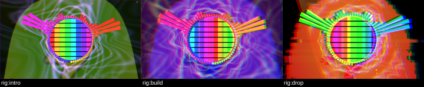

# Dubstep Machine rig

An all-in-one audio/visual dubstep setup in one FL Studio **Patcher**: Slicex, FPC, Vital, Surge XT, Flex and **MoshDeck VJ**, cross-linked into a web, with every control on a **Traktor Kontrol S2 MK3** and an **M-VAVE SMC-PAD**.

| File | What it is |
|---|---|
| [PATCHER_BUILD_GUIDE.md](PATCHER_BUILD_GUIDE.md) | step-by-step build of the Patcher: modules, note zones, audio cables, Peak/Formula controller links, saving it as your preset |
| [CONTROLLER_MAP.md](CONTROLLER_MAP.md) | every S2 MK3 and SMC-PAD control → Control Surface element → sound targets + visual targets, plus the MoshDeck macro reference |
| `dubstep-machine.mdvj` | ready-to-load MoshDeck VJ scene (MoshDeck → **Load Scene**) with all 16 macros pre-wired |

*MoshDeck rendering this scene in the automated test: intro (macros at 0), build (50 %), drop (DROP on).*

The scene is generated by `Tests/BuildDubstepRig.cpp` (`MoshDeckRigBuilder rigs/dubstep-machine/dubstep-machine.mdvj`) using the plugin's own scene code, so it always matches the current plugin.
